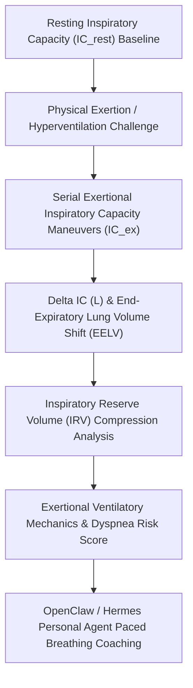

# Pulmonary Dynamic Hyperinflation (IC Tracking) Skill

[](LICENSE)
[](https://www.python.org/)
[](requirements.txt)
[](mcp_server.py)
[](SKILL.md)

Zero-dependency sovereign personal agent skill for non-invasive evaluation of exertional Inspiratory Capacity drop (Delta IC), End-Expiratory Lung Volume (EELV) air trapping, and ventilatory mechanics reserve.



## Features
- **Deterministic Math**: Pure Python standard library implementation with zero external dependencies.
- **Cardiopulmonary Exercise Testing (CPET) Standards**: Implements validated equations for serial IC tracking, EELV shifts, and IRV ceiling limits.
- **Dynamic Air Trapping & Dyspnea Prevention**: Early detection of mechanical diaphragm disadvantage during intense workouts or cardio intervals.
- **Model Context Protocol (MCP)**: Native JSON-RPC tool integration for LLMs and autonomous agents.

## Quickstart

```python
from client import PulmonaryDynamicHyperinflationClient

client = PulmonaryDynamicHyperinflationClient()
result = client.evaluate_dynamic_hyperinflation(
    resting_inspiratory_capacity_l=3.4,
    exertional_inspiratory_capacity_l=3.45,
    total_lung_capacity_l=6.5
)
print("Delta IC:", result["delta_ic_l"], "L")
print("Ventilatory Score:", result["ventilatory_mechanics_score"])
print("Classification:", result["classification"])
```

## License
Apache-2.0
